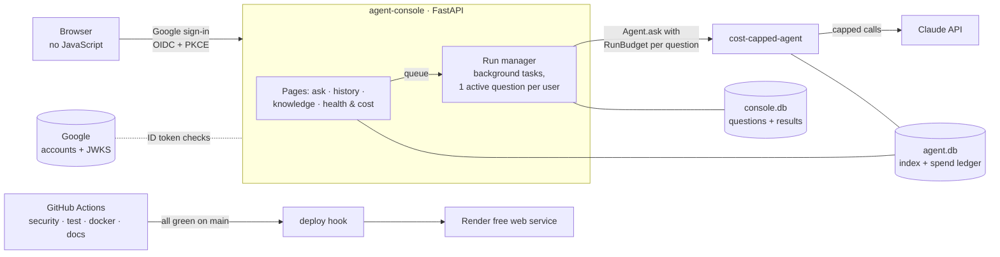

# agent-console

[](https://github.com/SaurabhTiwari95/agent-console/actions/workflows/ci.yml)
[](https://github.com/SaurabhTiwari95/agent-console/actions/workflows/codeql.yml)

A small internal platform for an AI agent: a web console where allowed people **sign in with Google**,
**ask the agent questions**, **browse what it knows**, and **watch what it costs**. Every push to `main`
that passes CI **deploys itself** to a free host.

It fronts [cost-capped-agent](https://github.com/SaurabhTiwari95/cost-capped-agent), a Claude agent that
answers from an indexed folder within hard spend caps. The console reuses its `Agent`, `Index`, `Store`,
`RunBudget` and `Settings`; it adds people, pages and operations around them.



## Contents

- [What you get](#what-you-get)
- [Prerequisites](#prerequisites)
- [Install](#install)
- [Run it locally](#run-it-locally)
- [Use it](#use-it)
- [Configuration](#configuration)
- [Run the tests](#run-the-tests)
- [Deploy](#deploy)
- [Troubleshooting](#troubleshooting)
- [Security model](#security-model)
- [How it scales](#how-it-scales)
- [Performance](#performance)
- [Design decisions](#design-decisions)
- [Project layout](#project-layout)
- [What's next](#whats-next)

## What you get

| Page | What it does |
|---|---|
| **Sign in** | Google OpenID Connect (authorization code + PKCE, state and nonce). Only verified emails on an allow-list get in. A dev login exists for localhost only |
| **Ask** | Send a question with a spend cap (at most the agent's per-question cap). It runs in the background; the page shows queued → running → done or stopped, then the answer, its sources, the agent's steps and the cost |
| **History** | Your past questions with status, answer and cost, newest first, paginated. Nobody else's |
| **Knowledge** | What the agent has indexed: files with summaries, full-text search with highlights, each file's lines with links from the answers' citations |
| **Health & cost** | Spend per day and per model from the agent's ledger, today against the daily cap, prompt-cache hit rate, the last runs and why they stopped, and readiness of the databases and index |
| **Ops** | `/healthz`, `/readyz`, JSON logs, security headers, rate limits, Docker image, Render blueprint, CI that deploys only when everything is green |

**156 tests** (99% coverage) run with no network at all: a scripted fake Claude client and a fake Google
that serves a real JWKS and signs real RS256 ID tokens, so the sign-in checks run for real.

## Prerequisites

| Tool | Version | Needed for | Get it |
|---|---|---|---|
| Python | 3.12 | Everything | <https://www.python.org/downloads/> |
| Git | any recent | Cloning, and installing the agent from GitHub | <https://git-scm.com/downloads> |
| cost-capped-agent | v0.1.0 | The agent itself | [cost-capped-agent](https://github.com/SaurabhTiwari95/cost-capped-agent) |
| Docker (optional) | 24+ | Running the image | <https://docs.docker.com/get-docker/> |
| A Claude API key (optional) | your own | Real answers (the demo client needs none) | <https://platform.claude.com/> |
| A Google Cloud project (optional) | — | Google sign-in (dev login needs none) | <https://console.cloud.google.com/> |

## Install

The console needs the agent installed as a package. Pick one of two ways:

- **From GitHub (the tagged release):** `requirements-agent.txt` holds
  `cost-capped-agent @ git+https://github.com/SaurabhTiwari95/cost-capped-agent@v0.1.0`.
- **From a local clone next to this one** (editable, handy while changing both):
  `pip install -e ../cost-capped-agent`.

### Windows (PowerShell)

```powershell
git clone https://github.com/SaurabhTiwari95/agent-console.git
cd agent-console
py -3.12 -m venv .venv
.\.venv\Scripts\Activate.ps1
pip install -r requirements-dev.txt
pip install -r requirements-agent.txt      # or: pip install -e ..\cost-capped-agent
python scripts/make_env.py                 # writes .env with a fresh SESSION_SECRET
```

### macOS / Linux

```bash
git clone https://github.com/SaurabhTiwari95/agent-console.git
cd agent-console
python3.12 -m venv .venv
source .venv/bin/activate
pip install -r requirements-dev.txt
pip install -r requirements-agent.txt      # or: pip install -e ../cost-capped-agent
python scripts/make_env.py                 # writes .env with a fresh SESSION_SECRET
```

`make_env.py` copies `.env.example` to `.env` (git-ignored) and fills in a random session secret.
The defaults are for your laptop: localhost, dev login on, and the **offline demo client** instead of
Claude, so nothing leaves your machine and nothing costs money.

## Run it locally

```bash
python -m agentconsole
```

Open <http://127.0.0.1:8000>. On start it indexes `sample_corpus/` (made-up "Acme Traders" documents,
offline and free) and prints JSON log lines:

```text
{"time": "...", "level": "INFO", "logger": "agentconsole", "msg": "index ready indexed=6 unchanged=0 removed=0"}
{"time": "...", "level": "WARNING", "logger": "agentconsole", "msg": "Google sign-in is not configured (GOOGLE_CLIENT_ID / GOOGLE_CLIENT_SECRET)"}
{"time": "...", "level": "INFO", "logger": "agentconsole", "msg": "agent-console started env=development claude=demo dev_login=True"}
```

`python -m agentconsole` refuses to bind to anything but a loopback address while dev login is on.

**With real Claude:** set `CLAUDE_CLIENT=anthropic` in `.env` and your key in the shell
(PowerShell: `$env:ANTHROPIC_API_KEY = "<your key>"`; macOS/Linux: `export ANTHROPIC_API_KEY=...`).
Every question is then capped by `AGENT_RUN_CAP_USD` and the day by `AGENT_DAY_CAP_USD`.

**With Google sign-in locally:** follow [docs/deploy.md](docs/deploy.md) step 2, register
`http://127.0.0.1:8000/auth/callback`, put the client ID and secret in `.env`, and add your address to
`ALLOWED_EMAILS`.

## Use it

These are from a real local run (dev login, demo client), captured as text from the pages. The demo
client is an offline stand-in that searches and reads the index like the model would; its costs are
simulated at the real model's prices.

**Sign in.** Signed out, every page redirects to `/login`:

```text
Sign in
Google sign-in isn't configured on this server.
[ Dev login as dev@example.com ]
Local development only: refused outside localhost and in production.
```

The session cookie it sets (on localhost; with `SESSION_COOKIE_SECURE=true` it is `__Host-console` and `Secure`):

```text
console_session=...; path=/; Max-Age=28800; httponly; samesite=lax
```

**Ask.** Submitting "When is a late fee charged, and can it be waived?" with a $0.10 cap returns
`303 → /requests/<id>` in 7 ms. The page shows `running` and refreshes itself every 2 seconds (a meta
refresh: no JavaScript). 1.3 s later:

```text
Question
When is a late fee charged, and can it be waived?
Status: done
Answer
A late fee can be waived once in any 12-month period if the overdue amount is paid within 7 days of
the fee being added. Ask your account manager.
Source: `faq.md:13-14`. (Demo mode: an offline stand-in for Claude wrote this.)
Sources
faq.md:13-14                      ← links to the file view with lines 13-14 highlighted
Run
Stop reason            done
Steps / API calls      3 / 3
Cost                   $0.0090 of a $0.1000 cap
Steps
search_index {"limit": 3, "query": "late fee charged waived"}
read_file {"end_line": 17, "path": "faq.md", "start_line": 1}
```

Asking again while a question is still running answers `409` with "You already have a question running".

**History:**

```text
Asked (UTC)          Status   Question                                             Cost
2026-11-09 18:31:09  done     When is a late fee charged, and can it be waived?   $0.0090
```

**Knowledge** lists the index, and search highlights the matches (shown here as `[ ]`):

```text
File                        Lines  Summary
README.md                       8
catalogue/products.md          27
faq.md                         17
handbook/payment-terms.md      27
handbook/returns.md            24
handbook/shipping.md           21

Search "late fee": 3 passage(s)
faq.md:1-17                 … **I was charged a [late fee]. Can it be removed?** A [late fee] can be waived once …
handbook/payment-terms.md:1-27  … After 30 days overdue, a [late fee] of 1.5% of the outstanding amount is added each month …
handbook/returns.md:1-24    … There is no [fee] for returns under 5,000. …
```

(Summaries appear once you run cost-capped-agent's `index --summarize`, which uses the cheap model.)

**Health & cost:**

```text
Today (UTC)        $0.0090 of $2.0000   [progress bar]   $1.9910 left today · $0.2500 cap per question
Last 7 days        $0.0090              Prompt cache hit rate 29%
Readiness          ok console db · ok agent db · ok index
                   Indexed files: 6 · runs in flight: 0 · client: demo
                   Answers: claude-opus-5-5 · summaries: claude-haiku-5-5

Spend per day and model
Day         Model            Purpose  Calls  Input  Output  Cache read  Hit   USD
2026-11-09  claude-opus-5-5  answer       3   1129     145         574  29%   $0.0090

Last runs
Asked (UTC)          Status  Stop reason  Steps  Cost
2026-11-09 18:31:09  done    done             3  $0.0090
```

**Health endpoints** (no sign-in, not rate-limited):

```bash
curl http://127.0.0.1:8000/healthz
curl http://127.0.0.1:8000/readyz
```

```text
{"status":"ok"}
{"status":"ready","console_db":true,"agent_db":true,"index":true}
```

`/readyz` answers `503` with the failing check when a database is unreachable or the index is empty.

### Docker

```bash
docker build -t agent-console .
docker run --rm -p 8000:8000 -v consoledata:/data \
  -e ENVIRONMENT=test -e CLAUDE_CLIENT=demo -e BASE_URL=https://console.example.com \
  -e SESSION_SECRET="$(python -c 'import secrets; print(secrets.token_urlsafe(48))')" \
  agent-console
```

The build stage fetches cost-capped-agent from GitHub (`requirements-agent.txt`), so that repo must be
pushed first. Dev login is refused inside the container (it binds `0.0.0.0`), so use Google sign-in
there, or run the app directly on your machine for dev login.

## Configuration

Environment variables or `.env`. The agent's own settings (`AGENT_*`) are cost-capped-agent's; the main
ones are listed at the end.

| Variable | Purpose | Default | Required |
|---|---|---|---|
| `ENVIRONMENT` | `development`, `test` or `production` | `production` | — |
| `BASE_URL` | Public origin; the OAuth redirect URI is `BASE_URL/auth/callback`. Must be https unless localhost | `http://127.0.0.1:8000` | in production |
| `SESSION_SECRET` | Signs the session cookie; 32+ random characters (`scripts/make_env.py`) | — | **yes** |
| `SESSION_COOKIE_SECURE` | `Secure` + `__Host-` cookie. `false` allowed only for a localhost `BASE_URL` | `true` | — |
| `SESSION_MAX_AGE_SECONDS` | Absolute session lifetime | `28800` (8 h) | — |
| `GOOGLE_CLIENT_ID` / `GOOGLE_CLIENT_SECRET` | Google OAuth web client ([docs/deploy.md](docs/deploy.md)) | — | in production |
| `ALLOWED_EMAILS` | Comma-separated addresses allowed in (case-insensitive) | — | in production |
| `OIDC_DISCOVERY_URL` | OpenID discovery document | Google's | — |
| `OIDC_ALLOWED_ISSUERS` | Accepted `iss` values | `https://accounts.google.com,accounts.google.com` | — |
| `DEV_LOGIN_ENABLED` / `DEV_LOGIN_EMAIL` | Local dev login; refused unless localhost and not production; the email must be on the allow-list | `false` / `dev@example.com` | — |
| `CLAUDE_CLIENT` | `anthropic` (real, needs `ANTHROPIC_API_KEY`) or `demo` (offline; refused in production) | `anthropic` | — |
| `ANTHROPIC_API_KEY` | Your Claude API key, read by the SDK | — | for real answers |
| `CONSOLE_DB_PATH` | The console's SQLite file (questions and results) | `data/console.db` | — |
| `INDEX_ON_START` | Folder indexed at start-up (offline; unchanged files skipped). Empty to skip | `sample_corpus` | — |
| `MAX_CONCURRENT_RUNS` | Answers in flight at once; the rest wait as `queued` | `2` | — |
| `RUN_TIMEOUT_SECONDS` | A run is cancelled after this | `300` | — |
| `MAX_QUESTION_CHARS` | Longest question accepted | `2000` | — |
| `RATE_LIMIT_LOGIN_PER_MINUTE` | Sign-in attempts per client address | `10` | — |
| `RATE_LIMIT_ASK_PER_MINUTE` | Questions per user | `6` | — |
| `RATE_LIMIT_GLOBAL_PER_MINUTE` | All requests per client address (health checks excluded) | `300` | — |
| `TRUST_PROXY_HEADERS` | Take the client address from the right-most `X-Forwarded-For` entry (set on Render) | `false` | — |
| `MAX_BODY_BYTES` | Largest request body | `16384` | — |
| `LOG_LEVEL` | `DEBUG`, `INFO`, `WARNING`, `ERROR` | `INFO` | — |
| `AGENT_DB_PATH` | The agent's index and spend ledger | `data/agent.db` | — |
| `AGENT_RUN_CAP_USD` / `AGENT_DAY_CAP_USD` | Cap per question (the most a user can choose) / per UTC day across everyone | `0.25` / `2.00` | — |
| `AGENT_ANSWER_MODEL` / `AGENT_SUMMARY_MODEL` | Models for answers / summaries | `claude-opus-5-5` / `claude-haiku-5-5` | — |

## Run the tests

```bash
pytest
```

```text
156 passed ... TOTAL ... 99%
```

What they cover, all offline:

- **Sign-in** through a fake Google (real RSA keys, JWKS, discovery and token endpoints served to Authlib):
  the happy path with the PKCE verifier checked against the challenge, and refusal of a wrong audience,
  wrong issuer, expired token, bad signature, HMAC-signed token, nonce mismatch or missing, unverified
  email, address not on the allow-list, several audiences without `azp`, state mismatch, replayed state,
  provider errors and a missing ID token.
- **Configuration** refusals: dev login in production or off localhost, the demo client in production,
  insecure cookies off localhost, weak secrets, a public bind with dev login.
- **Pages:** sign-in required everywhere, CSRF, validation, one question per user, queueing, the budget
  stop, failures and crashes, privacy between users, pagination, escaping of indexed content, security
  headers, size and rate limits, logs without personal data, restart recovery.

Lint, audit and the pre-publish scan:

```bash
ruff check . && ruff format --check .
pip-audit -r requirements-dev.txt
python scripts/prepublish_check.py
```

## Deploy

[docs/deploy.md](docs/deploy.md) walks through the one-time setup: the Render blueprint
(`render.yaml`), the Google OAuth client and its redirect URI, the allow-list, and the
`RENDER_DEPLOY_HOOK_URL` secret. After that, the CI `deploy` job calls the hook on every push to `main`,
only once `security`, `test`, `docker` and `docs` have all passed. Without the secret it skips cleanly.

**First CI run:** the `test` and `docker` jobs fetch cost-capped-agent from GitHub, so push that repo
(with the `v0.1.0` tag) first.

## Troubleshooting

| Problem | Fix |
|---|---|
| `configuration error: ... SESSION_SECRET must be a random value` | Run `python scripts/make_env.py` (or set a 32+ character secret) |
| `configuration error: ... production needs GOOGLE_CLIENT_ID ...` | `ENVIRONMENT` defaults to `production`. For local use, run `make_env.py` (it sets `development`), or fill in the Google values |
| `refusing to bind to 0.0.0.0: DEV_LOGIN_ENABLED needs a loopback host` | Dev login is for your own machine. Use `--host 127.0.0.1`, or turn dev login off |
| Google says `redirect_uri_mismatch` | The redirect URI in Google must be exactly `BASE_URL` + `/auth/callback`, same scheme, host and port |
| "That account isn't allowed" after Google sign-in | The address isn't in `ALLOWED_EMAILS`, or Google reports it unverified. While the consent screen is in *Testing*, add it as a test user too |
| Signed in, then sent back to the login page on every click (local http) | The browser drops `Secure` cookies on http. On localhost set `SESSION_COOKIE_SECURE=false` |
| Every question ends `failed: the Claude client isn't configured` or `client_error` | Set `ANTHROPIC_API_KEY` in the shell that runs the server, or use `CLAUDE_CLIENT=demo` |
| `pip install -r requirements-agent.txt` fails | Push cost-capped-agent with the `v0.1.0` tag, or install a local clone with `pip install -e ../cost-capped-agent` |
| A question shows `stopped` with `budget` | The question's cap or the day's cap was reached. The health page shows today's spend against the cap |

## Security model

- **Who gets in:** only people with a Google account on `ALLOWED_EMAILS` whose email Google has verified.
  Authlib runs the authorization-code flow with `state`, `nonce` and PKCE (S256) and verifies the ID
  token's RS256 signature against Google's JWKS, its issuer, audience, expiry and nonce. Authlib checks
  the audience only when told to, so it is passed explicitly; the console then re-checks issuer, audience
  (and `azp` with several audiences), expiry, `email_verified` and the allow-list itself.
- **Sessions:** a signed cookie (`HttpOnly`, `SameSite=Lax`, `Secure`, `__Host-` prefix) with an
  absolute 8-hour limit; cleared on sign-in so nothing carries over, and re-checked against the
  allow-list on every request.
- **Forms:** every POST carries a per-session CSRF token compared in constant time; bodies are capped.
- **Dev login** can't reach production: refused at start-up unless `BASE_URL` is localhost and
  `ENVIRONMENT` isn't `production`, refused by the runner on a non-loopback bind, and 404 for any request
  not from the same machine.
- **Browser:** CSP `default-src 'none'; style-src 'self'; ...` with no scripts at all and no inline
  styles, so injected markup can't run; all content (including indexed files) is escaped by Jinja.
- **Data:** each user sees only their own questions (the shared health page shows runs without
  questions). The agent's tools read only the index. Spend is capped per question and per day.
- **Logs and errors:** JSON lines with a request id; emails appear only as a short hash; no question
  text, answers, cookies, secrets or query strings (OAuth codes travel in query strings, so uvicorn's
  access log is off). Error pages are generic, and a refused configuration doesn't echo its values.
- **Supply chain:** pinned dependencies, pip-audit, Dependabot, CodeQL, gitleaks, a non-root
  multi-stage image. See [SECURITY.md](SECURITY.md).

## How it scales

Today it is **one process**: background runs are asyncio tasks, rate limits live in memory, and the data
is two SQLite files. That suits a team console and Render's free single instance.

| Load | What breaks first | Fix |
|---|---|---|
| 10× users | Concurrent answers (each is minutes of model time) | Raise `MAX_CONCURRENT_RUNS`; the agent's daily cap still holds because reservations are atomic in the ledger |
| 10× page views | Nothing yet: ~500 requests/s per page on a laptop, one process | — |
| More than one instance | In-memory rate limits and runs; SQLite's single writer; the ledger is per machine | Move both databases to PostgreSQL (the ledger keeps its reserve-then-settle transaction), runs to a queue with a worker (Redis + arq or Celery), rate limits to Redis. The pages are already stateless: the session lives in the signed cookie |
| 100× questions | Model cost and latency | Cheaper answer model or lower effort for simple questions; cached prefixes already cut input cost; batch summaries at half price |

The free plan's disk isn't persistent, which matters for the spend ledger: see
[docs/deploy.md](docs/deploy.md#things-to-know-about-the-free-plan).

## Performance

Measured on a busy Windows laptop, one uvicorn process, signed in, sample index, `scripts/loadtest.py`
with 400 requests per page at concurrency 10 (the global rate limit raised for the test):

| Page | p50 | p95 | Requests/s |
|---|---|---|---|
| `/ask` | 16.9 ms | 47.9 ms | 466 |
| `/history` | 12.6 ms | 42.6 ms | 546 |
| `/knowledge` | 15.9 ms | 32.1 ms | 534 |
| `/knowledge/search?q=late+fee` | 18.9 ms | 24.2 ms | 520 |
| `/knowledge/file?path=faq.md` | 19.1 ms | 28.2 ms | 506 |
| `/health` | 17.3 ms | 34.7 ms | 507 |

A question with the demo client finishes in about 1.3 s (it waits 0.4 s per simulated model call).
With Claude, the model's time dominates; the console adds a few milliseconds.

**What profiling showed:**

- `/health` was the slowest page (p50 33.7 ms, 278 requests/s). The profile showed no slow query: the time
  went to five separate hand-offs to the worker thread for five small reads. Doing them in one hand-off
  brought it to 17-20 ms and about 500 requests/s, in line with the other pages.
- The **first question after start-up** took over 4 seconds before any model call: `Agent.ask()` imports
  the Anthropic SDK for its error types, and that first import is slow on Windows. The console now imports
  it during start-up instead, so no user waits for it.
- Templates are no longer re-checked on disk for every render outside development.

## Design decisions

- **Reuse, don't re-implement, the agent.** The console calls `Agent.ask()` with a fresh `RunBudget` per
  question, and reads the same `Index` and `Store`. It never builds Claude requests itself, so the caps,
  routing and prompt caching stay in one place.
- **A separate SQLite file for the console** (`console.db`, next to `agent.db` in the same data folder):
  the agent's schema belongs to the agent library; the console's questions and results are its own, with
  their own migrations. A partial unique index enforces "one active question per user" in the database.
- **Background tasks in the process, not a queue,** because one instance is the target; the table
  already has the states a worker would need (`queued`, `running`, ...), and a restart marks
  interrupted runs as failed.
- **Server-rendered HTML with no JavaScript:** a strict CSP is easy to keep, there's nothing to build,
  and status polling is a meta refresh.
- **Authlib for OIDC** rather than hand-rolled JWT checks, plus an independent second check of the claims
  that matter. Tests run Authlib against a fake Google with real keys, so the checks are exercised, not
  mocked away.
- **Fail closed at start-up:** unsafe combinations (dev login off localhost, demo client in production,
  insecure cookies off localhost, weak secrets) stop the app rather than log a warning.
- **Deploy from CI, not from the host's git hook,** so only commits that pass every job reach users.

## Project layout

```text
agentconsole/
  main.py         app factory, middleware (headers, limits, logs), errors, /healthz, /readyz
  auth.py         Google OIDC via Authlib, claim checks, dev login, sessions, logout
  pages.py        ask, requests, history, knowledge, health & cost
  runs.py         background runs around Agent.ask(), caps, concurrency, timeouts
  db.py           console.db: requests table, migrations
  costs.py        spend summaries from the agent's ledger, short cache
  security.py     CSP and headers, CSRF tokens, client address, rate limiter
  config.py       settings and the start-up refusals
  demo_client.py  offline stand-in for Claude (local demos only)
  logs.py         JSON log lines
  templates/, static/app.css
sample_corpus/    made-up Acme Traders documents
scripts/          make_env.py, loadtest.py, prepublish_check.py
tests/            fake Claude, fake Google; auth, config, pages, units
docs/             deploy.md, CHECKLIST.md
render.yaml, Dockerfile, .github/workflows/
```

## What's next

- PostgreSQL and a Redis-backed queue for more than one instance.
- Stream the answer as it is written (server-sent events) instead of refreshing.
- A per-user daily cap alongside the shared one.
- An admin view of every user's spend.

---

AI-assisted (Claude Code); design and review by me.

Licence: [MIT](LICENSE). Security: [SECURITY.md](SECURITY.md).
